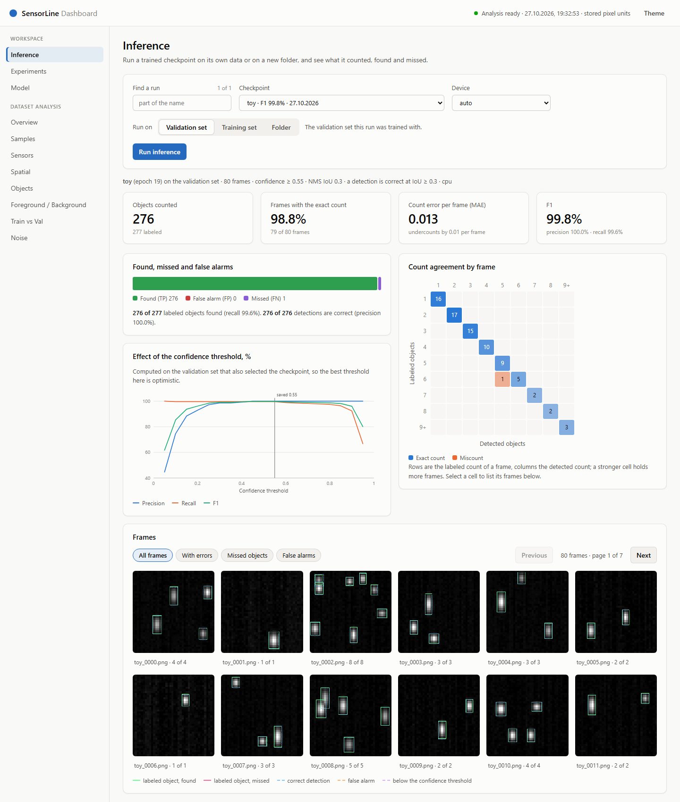
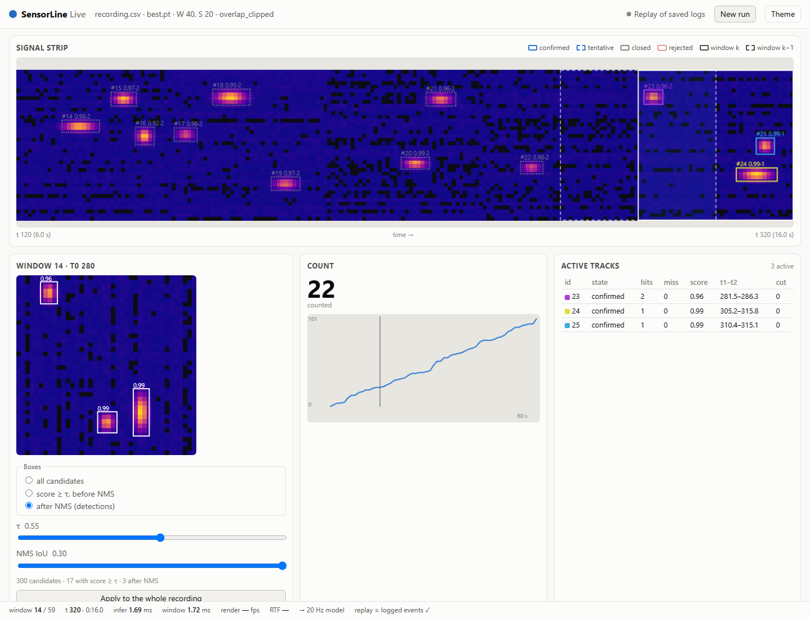

# SensorLine

Counting objects in the signal of a 40-sensor infrared line with a small
bounding-box detector. Architectures are assembled from YAML, trained under
identical conditions, tuned with Optuna, fine-tuned on new data with a guard
against forgetting, and compared by counting and detection quality.



*The local dashboard after running a checkpoint on the synthetic quick-start
dataset: counts, frames with the exact count, a confidence sweep and every
frame with its labeled and detected objects.*

## The problem

Objects pass a line of 40 infrared sensors. A recording is a 40 × T intensity
matrix (sensor × time), stored as an 8-bit grayscale image; an object shows up as
a blob about 4 sensors wide and 7 time steps long. A frame holds 1 to 24 objects,
and neighbouring objects touch or overlap, so the count is taken as the number of
detected boxes rather than from thresholds or peak counting.

Models are judged on both groups of metrics, never on the loss:

- counting: count MAE, RMSE and bias per frame, share of frames with the exact count;
- detection: precision, recall, F1, mAP50, mAP75, mAP50-95.

## Results

Ten variants of the detector were compared on the real data (703 training and
231 validation frames, 723 validation objects, with the labels of that time; the
labels have been corrected since, so the current data give other numbers). Each variant got the same Optuna
search: 40 trials of 60 epochs over the same 22 hyperparameters (learning
rate, optimizer, batch size, loss weights, augmentation strengths), selecting
by validation F1. The table shows the best trial of each search.

| Config | Change against the control | Params | F1 | mAP50-95 | Count MAE | Exact count | Errors (FP+FN) | ΔF1 vs control, 95% CI |
|---|---|---:|---:|---:|---:|---:|---:|---|
| theory_00_control | plain backbone, no neck, simple head | 54 549 | 0.9869 | 0.709 | 0.082 | 94.4% | 19 | — |
| theory_01_fusion | early features fused with deep context | 55 381 | 0.9869 | 0.688 | 0.065 | 93.9% | 19 | [−0.008, +0.009] |
| theory_02_decoupled | separate box and objectness branches | 68 429 | 0.9882 | 0.709 | 0.074 | 93.5% | 17 | [−0.004, +0.008] |
| theory_03_fusion_decoupled | fusion + decoupled head | 69 261 | 0.9882 | 0.712 | 0.074 | 94.4% | 17 | [−0.003, +0.006] |
| theory_04_fusion_refine | fusion, a 3×3 refinement, decoupled head | 78 541 | 0.9896 | 0.704 | 0.056 | 95.7% | 15 | [−0.003, +0.009] |
| theory_05_context_balance | context redistributed over depth, same size | 54 549 | 0.9848 | 0.633 | 0.095 | 92.6% | 22 | [−0.008, +0.004] |
| theory_06_eca | channel attention after the backbone | 54 552 | 0.9854 | 0.675 | 0.091 | 92.2% | 21 | [−0.007, +0.004] |
| theory_07_pyramid | downsampling 40→20→10 with an FPN | 76 767 | 0.9876 | 0.670 | 0.078 | 94.4% | 18 | [−0.005, +0.006] |
| theory_08_axial_tcn | dilated TCN along time, depthwise along sensors | 62 389 | 0.9869 | 0.709 | 0.074 | 93.5% | 19 | [−0.007, +0.007] |
| theory_09_axial_attention | self-attention along time and along sensors | 63 125 | 0.9869 | 0.688 | 0.082 | 92.2% | 19 | [−0.007, +0.008] |

**No variant is distinguishable from the control.** The last column is a
paired bootstrap over validation frames against the control model, and every
interval contains zero: the best and the worst variant differ by 7 errors out
of 723 objects. The metrics also rank the variants differently (fusion has a
lower count MAE but a lower mAP than the control), as noise would. On this
data the plain 55k-parameter model is as good as the variants with fusion,
attention, a pyramid or a decoupled head; the added complexity does not pay off.

How far to trust the numbers:

- they come from the validation set that also selected the best of 40 trials,
  so they are optimistic; there is no independent test set yet;
- 2 validation frames are identical to training frames (reported in
  `data_audit.json` of every run);
- the data are not public; the synthetic dataset below reproduces their format,
  not their difficulty.

Telling the variants apart would take an independent test set, or retraining
the best parameters of each variant with several seeds and comparing the means.

The intervals come from the saved per-frame results of the best trials
(10 000 resamples; another seed moves a bound by at most 0.001):

```bash
python tools/compare_runs.py runs/theory_00_control_search runs/theory_0[1-9]_*_search
```

### Fine-tuning check on synthetic data

A base model trained on the toy data (A) is fine-tuned on frames with longer,
dimmer objects (B: 12-20 instead of 4-10.5 time steps, brightness 0.25-0.5
instead of 0.55-1), 15 epochs, CPU:

| Fine-tuning | F1 on A | Count MAE on A | F1 on B | Count MAE on B | ΔF1 on A, 95% CI |
|---|---:|---:|---:|---:|---|
| none (base model) | 0.9982 | 0.013 | 0.9269 | 0.425 | — |
| plain: full rate, no replay, no check | 0.9854 | 0.075 | 0.9979 | 0.013 | [−0.024, −0.004] |
| replay at a tenth of the rate | 0.9946 | 0.037 | 0.9959 | 0.025 | [−0.009, +0.000] |
| replay and the reference check | 0.9946 | 0.037 | 0.9959 | 0.025 | [−0.009, +0.000] |

Plain fine-tuning learns B and measurably forgets A; with replay the loss on A
stays within noise (one seed, 80 frames of A), while B is learned almost as
well. On a GPU the numbers differ slightly and the picture is the same. The
check here allowed a count MAE rise of 0.05: the default 0.01 is less than
one frame miscounted by one object on these 80 frames, so it accepts no epoch
and keeps the base weights; the run warns about such a limit.

```bash
python tools/finetune_demo.py demo --device cpu   # about 3 minutes on a CPU
```

## Quick start

Python 3.12 or newer. Install `torch` and `torchvision` together for your
machine (CPU or CUDA) as [pytorch.org](https://pytorch.org/get-started/locally/)
describes, for example `pip install torch torchvision --index-url
https://download.pytorch.org/whl/cpu`; the package installs the rest. Installed
separately, `torchvision` from PyPI may replace a CUDA build of `torch`.

```bash
python -m venv .venv
source .venv/bin/activate            # Windows: .venv\Scripts\activate
pip install -e ".[optuna]"

python tools/make_toy_data.py        # toy_data/: 300 training and 80 validation frames
python train.py --config configs/toy.yaml        # about a minute on CPU, seconds on a GPU
python test.py --config configs/toy.yaml --checkpoint runs/toy/best.pt
python dashboard.py --config configs/toy.yaml     # opens the dashboard in the browser
```

The toy model reaches F1 ≈ 0.998 on its validation set: the synthetic blobs
are easier than real objects; the point is to see the whole pipeline work.

## What is in the project

- **Architectures from YAML.** A backbone is a list of blocks (`conv`,
  `residual`, `depthwise`, `tcn`, `eca`, `axial_attention`), followed
  by an optional neck (`feature_fusion` of two layers, or `fpn` over several
  resolutions) and a box head (`bbox` or `bbox_decoupled`). Kernels, strides and
  dilations are `[sensor, time]` pairs. `tools/model_info.py` prints the shapes,
  parameters and receptive field before any training.
- **Reproducible training.** Seeds and deterministic algorithms make a run
  repeat bit for bit on the same device. The checkpoint stores the config and
  fingerprints of the training and validation data, and every run reports
  identical frames shared by train and val. The best epoch is chosen on
  validation: count MAE, then mAP50, then loss.
- **Hyperparameter search.** `--optuna` runs a validation-only search over
  training, loss, augmentation and threshold parameters (never the
  architecture); a search can be resumed, and refuses to if the data or the
  config changed. `--best-params` trains once with the result.
- **Fine-tuning with a guard against forgetting.** `--finetune` continues a
  checkpoint on new data with a reduced learning rate, replays samples of the
  original training data, and accepts an epoch only if F1 and count MAE on the
  original validation set stay within set limits (see the check below).
- **One evaluation.** `test.py` and the dashboard run the same code, so the
  same data give the same metrics, predictions and report.
- **A local dashboard** (`python dashboard.py --config <model YAML>`): dataset statistics
  (sensors, noise, correlation, object sizes, train/val drift, duplicates),
  inference with a per-frame gallery of found, missed and false detections,
  the list of runs, and model size, MACs and measured speed. Training stays
  on the command line. It uses only the standard library on the server side.

## Counting in a long recording



`python track.py` opens a local page (127.0.0.1) that counts the objects of a
CSV recording of the sensor line with a trained checkpoint: the recording is
cut into overlapping windows of the size the model was trained on, the model
finds boxes in every window, and a tracker links them across windows so that
each object is counted once. The page shows the signal, the windows, the count and
the tracks while the run goes, and can reopen a saved run and recompute it with
other thresholds. `tools/track_run.py` does the same without the page, and
`tools/track_folder.py` summarizes a folder of recordings. Every decision comes
from the model and the tracker; nothing is compared with labels.

Recordings of stored pixel values ("Pixels" on the page, `data.input_kind:
pixels`) work with any checkpoint; `tools/frames_to_csv.py` makes one from the
frames of a split, and [docs/guide.md](docs/guide.md#counting-in-long-recordings)
shows a run on the toy model of the quick start. Raw ADC recordings (the
default, `data.input_kind: raw_adc`) are averaged and scaled the way the training
frames were made from the conveyor recordings; the numbers of that transform are in
`configs/tracking/default.yaml`. The data are not public.

## Usage

```bash
# Architecture check: shapes, parameters, receptive field for a 40 x 120 input
python tools/model_info.py --config configs/theory_00_control.yaml --time 120

# Train; --epochs, --output-dir, --device, --seed override the YAML
python train.py --config configs/theory_00_control.yaml
python train.py --config configs/theory_00_control.yaml --dry-run      # validate and print the plan

# Search, then train with the best parameters
python train.py --config configs/theory_00_control.yaml --optuna configs/optuna.json \
    --epochs 30 --trials 20 --output-dir runs/optuna_control
python train.py --config configs/theory_00_control.yaml \
    --best-params runs/optuna_control/best_params.json --epochs 100 --output-dir runs/control_tuned

# Fine-tune a checkpoint on another dataset (a folder with data.yaml)
python train.py --config configs/theory_00_control.yaml --finetune runs/control_tuned/best.pt \
    --data path/to/new_dataset --epochs 20 --output-dir runs/control_finetuned

# Evaluate on validation, on an independent labeled folder, or predict for unlabeled frames
python test.py --config configs/theory_00_control.yaml --checkpoint runs/control_tuned/best.pt
python test.py --config configs/theory_00_control.yaml --checkpoint runs/control_tuned/best.pt \
    --split test --data-dir path/to/test
python test.py --config configs/theory_00_control.yaml --checkpoint runs/control_tuned/best.pt \
    --unlabeled --data-dir path/to/new_frames

# Compare models with a baseline: paired bootstrap over the frames both were evaluated on;
# a folder is a run, a test.py report or an Optuna study (its best trial)
python tools/compare_runs.py runs/control_tuned runs/fusion_tuned --metric f1
python tools/compare_runs.py runs/control_tuned/evaluation_test runs/fusion_tuned/evaluation_test
```

A dataset is a folder with `images/` and YOLO `labels/` (one class). A
`data.yaml` next to the splits describes it, in the same form as the `data`
section of a model YAML; `tools/make_toy_data.py` writes one. The options,
training modes, dashboard sections and tracking are described in
[docs/guide.md](docs/guide.md).

## Configuration

A model YAML has five sections; see `configs/theory_00_control.yaml`.

- `data`: the `train`, `val` (and optional `test`) folders, the image axis of
  the sensors, the number of `sensors` (40 when left out) and the pixel
  `scale` and `offset`;
- `model`: `backbone`, `neck`, `head`;
- `loss`: box loss (`iou`, `giou`, `diou`, `ciou`), objectness (`bce` or
  `focal`), weights, hard negatives; written in full, without defaults;
- `training`: optimizer, schedule, batch size, epochs, seed, device and
  augmentation (flips, rotation, shear, gain, noise, shifts; training only);
- `evaluation`: confidence and NMS thresholds, IoU for matching, limits.

Unknown options and invalid combinations are rejected when the YAML is loaded.

## What a run writes

```text
runs/<run>/
  best.pt                        weights, config, epoch, metrics, data fingerprints
  config.json, environment.json  the resolved config and the software versions
  model_info.json                layer shapes and receptive fields
  data_audit.json                split sizes and identical frames
  history.csv, history.json      losses and metrics per epoch
  metrics.json                   metrics of the best checkpoint on validation
  validation_samples.csv         counts and TP/FP/FN per frame
  validation_predictions.json    boxes and confidences
  summary.json                   run state, read by the dashboard
  finetune.json                  fine-tuning only: base checkpoint, limits, outcome
```

## Project layout

```text
train.py, test.py        training and checkpoint evaluation
dashboard.py, track.py   the dashboard and the counting page for long recordings; both open
                         in the browser on the first free port from 8008 and 8010
tools/                   analyze (statistics as JSON), model_info, compare_runs, make_toy_data,
                         finetune_demo (the fine-tuning check above), track_run,
                         track_folder, frames_to_csv
configs/                 the ten compared models, the toy config, the Optuna search space
src/sensorline/          the core: data, models/, losses, trainer, evaluation, inference,
                         finetune, optuna_search, config; it does not import analysis/
src/sensorline/tracking/ windows, detector, tracker and the counting page
src/sensorline/analysis/ the dashboard and the dataset statistics on top of the core
tests/                   data, model, metrics, train.py end to end, dashboard requests
docs/                    the guide and images
```

## Development

```bash
pip install -e ".[optuna,dev]"
python -m ruff check .
python -m unittest discover -b -s tests     # -b shows the output of failing tests only
```

GitHub Actions runs the same lint and tests on Ubuntu and Windows with the
CPU build of PyTorch.

## Limitations

- One data source (grayscale images with YOLO labels) and one class; all
  frames of a dataset have the same number of sensors (`data.sensors`).
- No independent test set; published numbers are validation numbers.
- The dashboard is a single-user local tool and listens on 127.0.0.1 only.

## License

[MIT](LICENSE)
